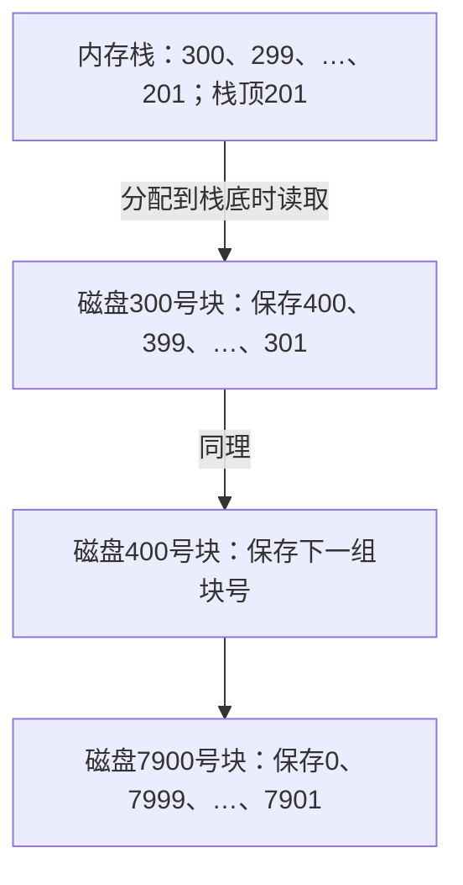
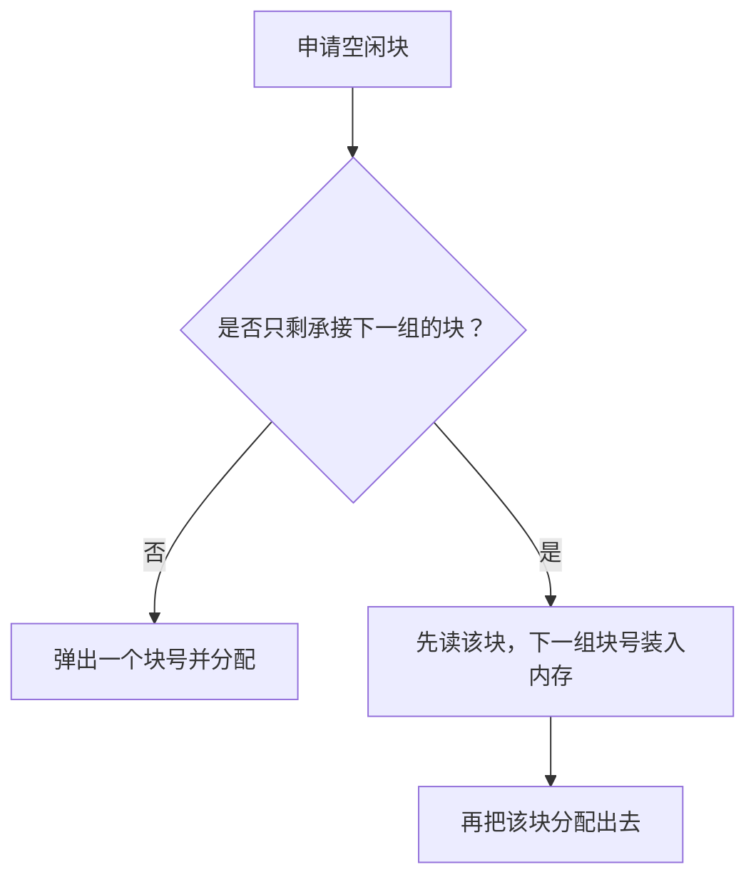
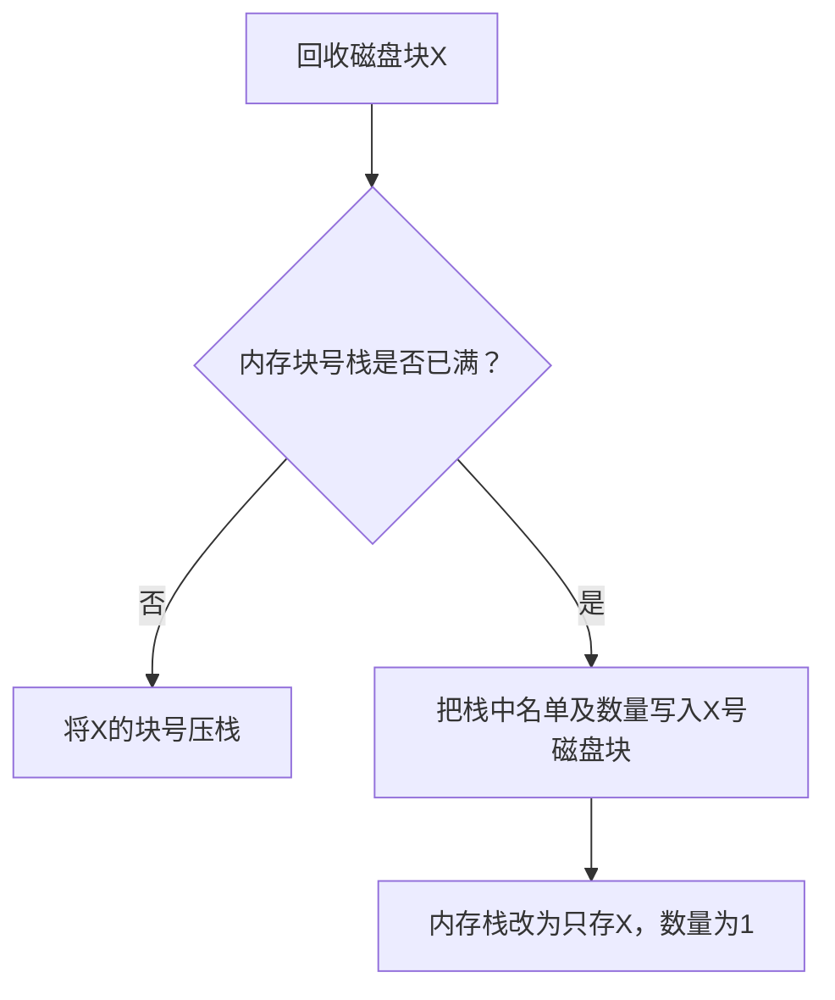

# 成组链接法

## 核心结论
用于管理空闲磁盘块。把空闲块号分组，在内存只保存当前一组块号；每组留一个空闲块暂存下一组的块号表，依次链接。不是文件内容的链接分配，也不是硬链接/软链接。

## 图片对应关系
按用户提供图4.22：内存块号栈存数量100及块号300、299、…、201；栈顶201，栈底300。数量100是当前组空闲块数，不是全盘空闲块数。栈中存的是块号而不是100个块的实际内容。

300号磁盘块暂存下一组信息：数量100及400、399、…、301。400号块保存再下一组信息。图中每个框顶端的300、400是该磁盘块自身编号；框内400等才是所保存的块号。

这张图选择当前组最后分配的块（300、400等）作为承接下一组的块。正文“第一个盘块”可按其栈内排列理解，不能死记为编号最小的块，应以图的栈顶、栈底为准。

## 分配
依次弹出201、202、…、299，把对应磁盘块分给用户，数量逐次减1。只剩300时，先读取300号块，将下一组块号及数量装入内存栈，再把300号块分给用户。此后从301继续分配。

300号块在暂存块号表时仍属于可分配空闲块，不是永久占用的索引块；必须先接过名单，再覆盖其内容。

## 回收
栈没满：直接将被回收块的块号压栈，数量加1。
栈已满：把当前整张块号表和数量写入被回收块X，再让内存栈只保存X，数量置1。以后分配到X时先读回其中的名单，再分配X。

## 末组与易混点
7900号块内保存末组99个实际空闲块的块号7901～7999，另有0作为结束标志。0不是可分配的空闲块，99不把0算入。用完末组实际块并遇到结束标志后，无下一组可读。

记忆：分配——栈里拿，见底换名单；回收——栈里放，满了把名单装进回收块。

## 复习自测
- 为什么300号块可以在读出下一组表后分给用户？
- 回收块X时若栈满，写入的是当前栈还是下一组表？
- 数量100为什么不是全盘剩余空闲块数？

## 关联笔记
[[专业课索引]]、[[复习清单]]。

## 来源
用户提供的“成组链接法”教材截图，图4.22；具体版次、页码未提供。
